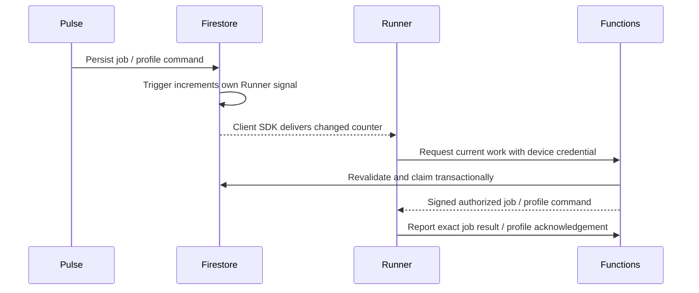

# Runner notifications (TES-368)

A Runner holds one outbound **Firestore client SDK** document listener. No
Functions/Cloud Run request is kept open to wait for work. The listener is a
wake-up hint; existing authenticated endpoints and transactions still decide
which job can be delivered, whether its signature/scope are valid, and whether
a profile patch is authorized. Counters tolerate repeated and out-of-order
Firestore trigger delivery. Runner execution stays single-flight.

## Timing and recovery

- Startup, each new subscription and local config/profile changes reconcile
  pending state. Events arriving during a job cause a subsequent drain; they
  never launch a second job. Profile commands can be applied during a job,
  while that job retains its captured settings.
- Idle heartbeat: 60 seconds (TTL remains 120 seconds). Active job cancellation
  checks remain every two seconds. No profile/job polling on those heartbeats.
- A 15-minute recovery pass covers a lost trigger, local filesystem watcher
  failure or unavailable stream; pending job expiry remains 30 minutes.
- Listener/bootstrap failure reconnects with exponential backoff (1–60s).
  Bootstrap HTTP and Firebase sign-in have bounded waits. Shutdown closes the
  listener, client app and file watcher. SDK auth/refresh credentials are only
  in memory; neither the custom token nor provider credentials are logged.
- The browser requests a fresh profile observation on open/explicit reload
  when its snapshot is stale. The authorized read coalesces requests over 10s.
  Signal-triggered reads never request another observation, avoiding a loop.
  Snapshot freshness and explicit request-ID acknowledgements remain mandatory.
- Visible profile/development views listen to authorized counters and coalesce
  refreshes. Hidden views detach; showing/reconnecting refreshes once. Profile
  freshness uses a local clock, not a server call. Permission/listener errors
  are shown and require reload/reconnect, not a polling storm.
- QA still dispatches on issue entry/context change, capacity release and
  actual Runner recovery. Heartbeats emit a separate availability signal only
  on a transition, so idle heartbeats do not invoke another trigger. Its backup
  schedule changes from 1 to 15 minutes and queries capacity-pending issues
  plus the exact legacy capacity diagnostic, scoped by workspace when known.

## Security boundary

`pulseRunnerSubscribe` authenticates the existing device credential, atomically
assigns a session generation tied to its current credential hash, and mints a
Firebase custom token for reserved UID `runner-device:<runnerId>`. The response
is no-store and contains public Firebase client configuration. The
`RUNNER_SIGNAL_API_KEY` parameter defaults to the same public project key as
the web client; configure it for other projects.

Device principals can only `get` their own `runner_signals/<runnerId>` document.
Rules validate current workspace, session generation, credential equality and
revocation against the private Runner document. They cannot list signals,
write anything, read jobs/profiles, or use the legacy broad client rules.
Device UID prefix and claim are excluded from all general authentication,
Platform Actions, browser telemetry and OAuth consent. Human issue signals
require current issue workspace membership; human profile signals recheck the
agent/Runner ownership, visibility and admin role. Signals contain counters
only, with no paths, job payload, patch, provider session or credential.

## Coordinated rollout (requires production publication)

1. Deploy the four new composite indexes and wait until ready before enabling
   narrowed pending-QA queries. Deploy rules **before** any device Firebase
   tokens are minted.
2. Enable the IAM Service Account Credentials API if needed. The function
   runtime principal needs `iam.serviceAccounts.signBlob` on its own signer
   service account. Grant `roles/iam.serviceAccountTokenCreator` scoped to that
   service account (not project-wide) or an equivalent narrowly scoped role.
   The current Pulse runtime is
   `775779828067-compute@developer.gserviceaccount.com`. Read-only inspection
   found no self account binding and project roles editor/event receiver/run
   invoker; editor does not include signBlob. No IAM changes were made here.
3. Deploy backend signals, bootstrap and QA recovery. Old Runners/UI continue
   to work. Verify custom-token sign-in and denied cross-device access.
4. Publish/restart the new Runner after its current job finishes, then deploy
   the frontend using its normal hosting process. Updating the npm package
   alone does not replace an already-running process. All existing instances
   need an upgrade to stop their old polling.
5. Compare equal idle windows and similar active workloads. Include Functions
   requests/billable time **and Firestore reads/writes**, reconnects and errors.

Rollback: the previous Runner still uses the original endpoints. Keep the
`runnerDevice`/reserved-UID exclusions in rules and browser/OAuth endpoints
**even when rolling back other code**: previously issued Firebase sessions may
still exist. Removing those exclusions could expose legacy client collections.
Never roll rules back wholesale after issuing device tokens.

## Cost evidence and limits

Monitoring last seven days on 2026-11-12: profiles 10,438 requests / 15,740.95
billable seconds; heartbeat 5,294 / 2,014.22s; poll 5,230 / 1,619.71s; pending-QA
scheduler 10,067 / 2,235.83s. A 2026-10-23–30 baseline had profiles 88,131 /
107,537.21s, but activity differed substantially. These are not invoice amounts
or a controlled savings experiment.

A healthy idle Runner now does four backup polls and four profile syncs per
hour instead of 120 each (two profile calls per sync). Sign-in/initial snapshots,
local changes, actual jobs, repeated events and reconnects add work. QA backup
invocations target 96/day instead of 1,440/day; event-driven recovery adds only
actual transitions. Firestore listeners and dependent rule reads are billable;
this moves work rather than making notifications free. Measure after rollout.

## Local verification

Use Node 22 and a disposable `demo-*` project; never production fixtures.

- `npm test` in functions: unit suite, including no QA scan on routine heartbeat.
- `npm run test:rules`: device isolation, credential rotation/revocation, human
  ownership and unchanged notification/profile rules.
- `npm run test:integration`: serialized integration files to avoid emulator
  transaction contention, while concurrency inside each scenario remains tested.
- `PULSE_RUNNER_SOURCE=/absolute/path/to/coordinated-runner npm run test:profiles`.
- `PULSE_RUNNER_SOURCE=/absolute/path/to/coordinated-runner npm run test:signals`:
  real Firebase custom-token sign-in + document subscription, disconnected
  changes/reconnect and revocation against Auth/Firestore emulators.
- Runner `npm test`: single-flight wakeups, recovery/backoff, profiles during
  work, identical local rewrites, shutdown and existing cancellation/job tests.
- Frontend `npm test`, production build and ESLint: no fixed cloud polling,
  hidden views, slow refreshes and exact profile acknowledgements.

The old QA handoff fixtures omitted TES-366 HEAD evidence and also failed with
unchanged main dispatch. Fixtures now report explicit matching HEADs when they
simulate completion; a new negative case rejects a changed HEAD without fresh
evidence. In-memory query mocks now implement immutable/nested filters. CI uses
explicit Bash pipefail so a failed test cannot be hidden by `tee`.
